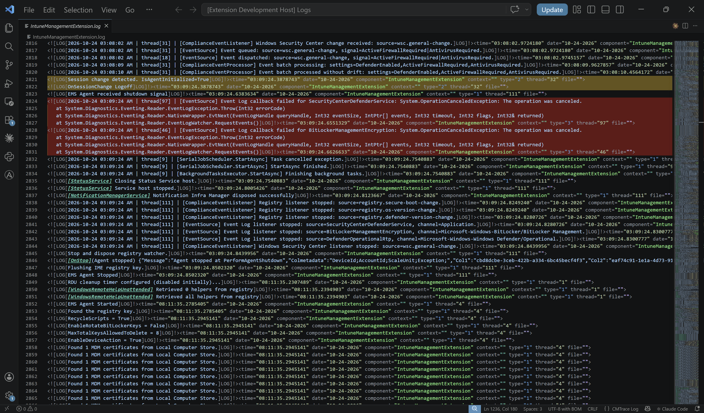

# MEM Log Viewer

Finally, easy-to-read Microsoft Endpoint Manager (SCCM, Intune, ConfigMgr) logs in VS Code! Provides element and severity highlighting for a log format that isn't well-supported by most editors/viewers.

If you administer Microsoft Intune or SCCM/ConfigMgr, you already know files like `IntuneManagementExtension.log`, `AppActionProcessor.log`, `smsts.log`, and many others the ConfigMgr/Intune client and site servers produce. Their XML-like format is very difficult to read in plain text, and the purpose-built tools for doing so (CMTrace, etc.) aren't great on modern high-resolution displays.

This extension provides VS Code-native coloring/highlighting for this file format, making it easy to quickly read a log in a scalable font size and identify useful information. It's perfect for the use case I often get, where I receive a bundle of Intune Management Extension logs to identify issues on systems I don't have direct access to.



## Features

**Tag highlighting for readability:** The message body, timestamp, date, component, thread, context, and source file each get their own TextMate scope, so your theme colors them appropriately, saving your vision and sanity.

**Sub-component tags are called out:** The ConfigMgr/Intune family of products logs many messages with bracketed prefixes such as `[Win32App][ActionProcessor]`. That leading chain gets its own scope and is bolded by default, so you can scan down a log by sub-component and pick out useful messages.

**CMTrace-style Warning and Error Highlighting:** Records with `type="2"` are given a warning background and `type="3"` an error background, across *every* line of a multi-line message; large blocks of output that PowerShell writes into IME logs are highlighted in full so they stand out.

**Automatic log content detection:** VS Code's built-in `log` language claims the `.log` extension. This extension looks at the first line of the document and reassigns it to the `cmtrace` language when it finds a CMTrace regex pattern. It works on every ConfigMgr and Intune log — and on anything else emitting the same format. Rotated logs such as ConfigMgr's `.lo_` files are picked up the same way.

**Log summary:** Run **MEM Log: Parse Active Log File** from the Command Palette for a count of Info, Warning, and Error records, plus the first few error messages. This is a quick way to find out whether a log is worth reading closely before you start scrolling.

## Usage

Open any CMTrace-format log file. Highlighting applies automatically.

For example, in Windows, the Intune Management Extension logs live here:

```
C:\ProgramData\Microsoft\IntuneManagementExtension\Logs\
```

For an error summary, open the Command Palette (Ctrl+Shift+P) and run **MEM Log: Parse Active Log File**.

If a log file is not detected automatically, you can manually select `cmtrace` as your file language using VS Code's language selection command.

## Settings

| Setting | Default | Description |
| --- | --- | --- |
| `mem-log-viewer.enableHighlighting` | `true` | Toggle the warning and error background highlighting. Syntax highlighting is unaffected. |
| `mem-log-viewer.warningColor` | `#ffc80033` | Background for warning records (`type="2"`). Any CSS color value, including `rgba()`. |
| `mem-log-viewer.errorColor` | `#ff000033` | Background for error records (`type="3"`). Any CSS color value, including `rgba()`. |
| `mem-log-viewer.subComponentStyle` | `["bold"]` | Styles for leading sub-component tags like `[Win32App]`. Any combination of `bold`, `italic`, and `underline`; `[]` for none. |

The default highlight colors are deliberately less intense so they tint the line rather than obscuring your theme's coloring. If you use a light theme and find them too faint, raise the last two hex digits.

## The log format

Each CMTrace record looks like this:

```
<![LOG[message text]LOG]!><time="14:22:07.123456" date="10-4-2026" component="IntuneManagementExtension" context="" type="3" thread="12" file="">
```

`type` is the severity: `1` = Info, `2` = Warning, `3` = Error. Other values
(`4` = Verbose, for instance) exist but are not highlighted. This renderer currently doesn't rearrange the log file's order, but that's something I'm working on.

## Known limitations

- None yet (this is v1.0!)

## Roadmap

- CMTrace-style bottom panel or text flyout that reorders lines to be more readable and strips extraneous text and tags
- More functional summarizer command (what's there is basically a placeholder in v1.0)
- Improvements to rendering speed

## Contributing

Issues and pull requests are welcome at
[github.com/torbenson/MEMLogViewer](https://github.com/torbenson/MEMLogViewer).

```powershell
npm install
npm run compile   # or: npm run watch
npm test          # parser unit tests
```

Press <kbd>F5</kbd> to launch the Extension Development Host, then open a log file in the new window. <kbd>Ctrl</kbd>+<kbd>R</kbd> reloads the window after a change.

If you change parsing behavior, add a test case to `src/test/parser.test.ts`. The malformed-input tests there encode defects and can help check for regressions. I ran this against a few Intune hosts and a sample SCCM site server's log directory, but I'm sure others trying this out in the real world will expose more issues and fixes are welcome!

## License

[MIT](LICENSE) © Eric Torbenson
